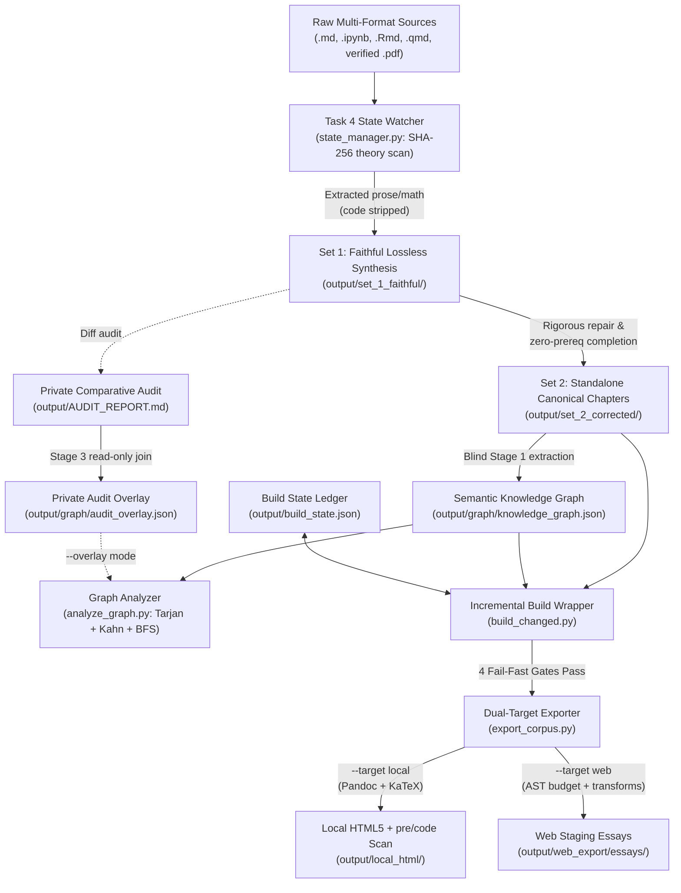
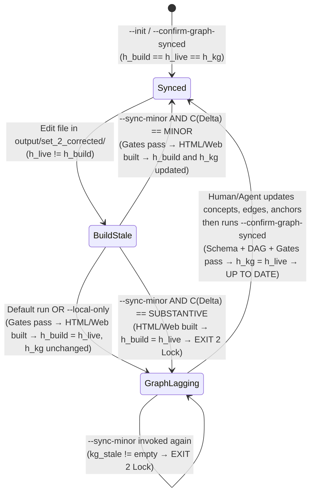
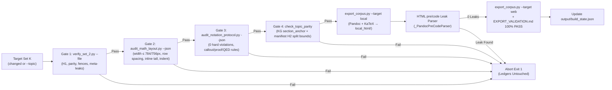
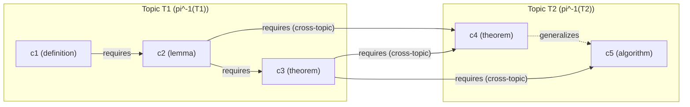
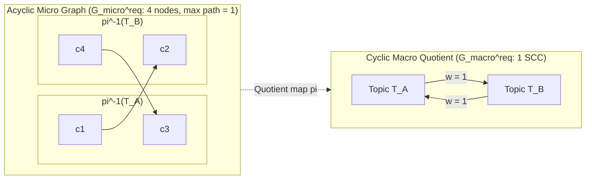
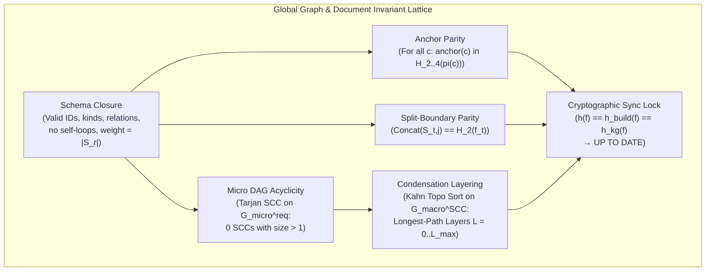

# Architectural Review & Mathematical Foundations of a Deterministic Technical Corpus Pipeline

**Document Scope.** This monograph presents an end-to-end systems engineering review and formal mathematical specification of a multi-stage knowledge-base distillation, verification, graph-theoretic indexing, and dual-target compilation pipeline. All operational invariants, algorithms, thresholds, and formulas are derived strictly from the production verification and build implementation (`scripts/`), using anonymized identifiers and synthetic examples throughout.

---

## Part I — System Architecture & Engineering Review

### 1. Abstract & Problem Formulation

Constructing and maintaining a multi-volume mathematical reference corpus from heterogeneous primary research notes (Markdown, Jupyter notebooks, R Markdown, Quarto documents, and standalone typeset PDFs) presents a coupled systems and formal-methods problem. Unlike general-purpose software documentation, technical mathematical prose imposes brittle semantic and syntactic invariants across thousands of interleaved natural-language and $\text{LaTeX}$ expressions. Five systemic failure modes dominate at corpus scale:

1. **Cross-Document Notation Drift.** Over extended authoring intervals, identical mathematical objects accumulate incompatible typographic encodings across chapters—for example, competing transpose operators (`^T`, `^{T}`, `^{\mathsf{T}}`, `^\top`), indicator glyphs (`\mathbb{1}`, `\mathbbm{1}`, `\mathbf{1}`), norm delimiters (`\| \cdot \|`, `|| \cdot ||`, `\lVert \cdot \rVert`), probabilistic operators (`E[\cdot]`, `P(\cdot)`, `\operatorname{Var}` vs. `\text{Var}`), and theorem/proof wrappers. Without automated enforcement, cross-chapter synthesis introduces semantic ambiguity and renderer incompatibilities.
2. **Display-Math Layout Overflow and Vertical Collision.** Editorial reading containers impose bounded horizontal widths (here, an `840px` outer column with `28px` horizontal padding per side, yielding a `784px` inner reading width—or `756px` inside nested callout blockquotes). Unbroken derivation chains overflow the column horizontally, while plain `\\` line breaks between rows containing fractions, nested radicals, or stacked limit operators (`\sum`, `\int`, `\lim`) collapse vertical inter-row clearance.
3. **Silent Dependency and Anchor Drift.** When chapters form an interdependent curriculum encoded in an external knowledge graph (`knowledge_graph.json`), benign editorial maintenance (fixing phrasing) differs fundamentally from structural edits (adding theorems, renaming `section_anchor` headings, or introducing new dependencies). Naively overwriting graph checksums on every HTML rebuild induces silent semantic drift; conversely, locking the entire build pipeline behind manual graph edits stalls routine proofreading.
4. **Target-Platform Serialization and Parser Impedance Mismatches.** Local archival study builds via `pandoc --katex` support GFM pipe tables, Markdown footnotes, and arbitrary heading depths, whereas web CMS targets backed by ProseMirror/Tiptap editors, relational JSONB storage, and serverless edge workers enforce hard limits on serialized JSONB payload bytes ($500{,}000\text{ B}$), request envelope size ($600{,}000\text{ B}$), visited AST nodes ($10{,}000$), tree nesting depth ($24$), disallowed heading levels (`h5`/`h6`, body `h1`), disallowed AST node types (tables, footnotes), and unsupported $\text{LaTeX}$ cross-references (`\label`, `\ref`, `\eqref`). Moreover, CommonMark/Pandoc list-continuation indentation rules silently turn over-indented math blocks into literal `<pre><code>` blocks.
5. **LLM Context Saturation ("Context Rot").** Delegating corpus-wide edits over hundreds of thousands of words to monolithic, stateful conversational agent sessions degrades adherence to fine-grained stylistic and mathematical constraints as context length grows.

The system reviewed here resolves these five failure modes by separating **creative/semantic mathematical reasoning** (executed by humans and stateless, bounded-context AI agents under an explicit formal contract) from **verification, graph topology auditing, change classification, and dual-target compilation** (executed by deterministic Python pipelines, an HTML parser, and Pandoc).

---

### 2. End-to-End Architecture & Visual Diagrams

#### 2.1 Full Ingestion, Synthesis, Verification, and Export Pipeline



#### 2.2 Two-Ledger State Machine (`build_state.json` vs. `knowledge_graph.json`)

The build subsystem tracks two strictly decoupled state ledgers over the Set 2 corpus $\mathcal{F}$: the **Build Ledger** $`\mathcal{L}_{\text{build}}`$ (`output/build_state.json`) and the **Graph Ledger** $`\mathcal{L}_{\text{graph}}`$ (`output/graph/knowledge_graph.json`).



#### 2.3 Fail-Fast Quality Gate & Post-Compilation Verification Cascade



---

### 3. Actors, Orchestration & Model Allocation Across Stages

The pipeline enforces a strict four-tier separation of responsibilities across human judgment, strategic specification, bounded execution, and deterministic computation:

| Tier | Actor Role | Typical Tooling / Substrate | Primary Responsibilities | Prohibited Operations |
| :---: | :--- | :--- | :--- | :--- |
| **1** | **Human Author & Domain Verifier** | Manual review, browser inspection, Git checkpointing | Domain-truth adjudication, authorship verification of standalone PDFs, approving style contracts, semantic sign-off on `SUBSTANTIVE` changes, managing remote publishing credentials | Hand-computing SHA-256 hashes, manually tracking AST byte counts, bypassing deterministic gates |
| **2** | **Strategic Orchestrator & Specification Architect** | High-reasoning conversational model | Designing multi-stage protocols (`tasks/TASK_*.md`), defining canonical notation contracts (`STYLE_GUIDE.md`), scoping bounded batch prompts, auditing failure modes and topological invariants | Directly batch-editing 30+ long manuscripts inside a single long-lived conversation thread |
| **3** | **Autonomous Execution Agents** | IDE / CLI coding and editing agents (e.g., Antigravity, Codex) | Authoring deterministic Python tooling (`scripts/*.py`), executing scoped 2–3 article normalization batches, refactoring equations and callouts, repairing gate failures, updating graph concepts/edges | Mutating read-only raw note directories, silently overriding `knowledge_graph.json` hashes without semantic review |
| **4** | **Deterministic Verification & Compilation Kernel** | Python 3 stdlib auditors, `html.parser`, Pandoc, KaTeX | Exact text extraction, structural hashing, layout width/spacing arithmetic, notation regex checks, Tarjan/Kahn graph verification, ProseMirror AST sizing, HTML/web compilation | Guessing mathematical validity, auto-rewriting ambiguous scalar vs. matrix symbols without context |

**Why Semantic Decisions Are Bounded While Verification Is Deterministic.**
Mathematical repair—such as recognizing whether a missing hypothesis in a convergence proof invalidates a lemma, or distinguishing an exponent $2^T$ (time horizon $T$) from a matrix transpose $\mathbf{A}^\top$—is inherently semantic and context-sensitive. Conversely, checking whether every row of an `aligned` block fits inside `784px`, whether every `\frac` transition uses `\\[6pt]` or `\\[10pt]`, whether `knowledge_graph.json` forms a concept-level DAG, or whether a Pandoc-compiled HTML document contains an accidental `<pre><code>` block are strictly decidable syntactic and combinatorial problems. Confining AI reasoning to small semantic batches and relegating invariant checking to deterministic Python scripts eliminates stochastic regression: an agent cannot hallucinate that a manuscript "looks compliant" when Gate 2 (`audit_math_layout.py`) returns exit code `1`.

---

### 4. Context Engineering & Stateless Batch Execution

#### 4.1 Mechanics of Context Degradation in Long-Running Threads

Consider an LLM processing a sequential context window of length $L$ tokens across $m$ sequential file-editing turns. Under standard self-attention, per-step compute scales quadratically as $\mathcal{O}(L^2)$ (with key-value memory scaling linearly as $`\mathcal{O}(L)`$), while the effective signal-to-noise ratio of early system constraints decays as intermediate tool outputs, file diffs, and raw $\text{LaTeX}$ payloads accumulate. When editing a mathematical corpus whose individual chapters span $`8{,}000`$–$`29{,}000`$ words ($`>15{,}000`$–$`45{,}000`$ tokens each), attempting to normalize dozens of chapters inside one persistent session drives $L$ rapidly past effective reasoning saturation:

- **Constraint Dilution ("Lost-in-the-Middle" Drift):** Subtle multi-part rules (e.g., keeping `**Proof.**` outside blockquotes while placing `> **Theorem.**` inside blockquotes, or applying three-tier `\\[6pt]`/`\\[10pt]` spacing rules) compete for attention against tens of thousands of tokens of previously edited equations.
- **Cross-File Contamination:** Variable conventions or section numbering from chapter $k$ leak into chapter $k+1$.
- **Unbounded Error Propagation:** Early formatting mistakes persist in conversation history as in-context examples, biasing later generations toward the flawed pattern.

#### 4.2 Modular Instruction Substrate & the 11-Batch Protocol Rollout

To eliminate context rot, the architecture replaces conversational memory with an **externalized constitutional substrate** on disk:

1. **Workspace Constitution (`GEMINI.md` / `AGENTS.md`):** Declares read-only source boundaries, task routing (`tasks/TASK_*.md`), standing notation/layout invariants, and the mandatory post-edit CLI gate sequence.
2. **Authoritative Typographic Contract (`STYLE_GUIDE.md`):** Encodes canonical object typography, allowed KaTeX environments, delimiter hygiene, structural callout grammar, heading-stability rules, and `784px` / three-tier spacing rules in $<200$ concise lines.
3. **Stateless Task Specifications (`tasks/TASK_1..6_*.md`):** Isolate each pipeline phase with explicit pre-conditions, isolation laws (e.g., blinding Set 1 / `AUDIT_REPORT.md` during pure Set 2 graph extraction and web export), and exit criteria.

During corpus-wide `STYLE_GUIDE.md` normalization across the 32-article Set 2 corpus, execution was partitioned into an **11-batch protocol rollout** (roughly 2–3 manuscripts per stateless batch). Each batch executed in a clean context window that:
1. Loaded `STYLE_GUIDE.md` and `GEMINI.md` fresh at step zero ($`L_0 \approx \text{const}`$),
2. Processed only its assigned slice of 2–3 articles while consulting `knowledge_graph.json` `section_anchor` invariants, and
3. Could not terminate until deterministic Python verification (`verify_set_2.py`, `audit_math_layout.py`, `audit_notation_protocol.py`) reported **zero violations** on every article in the batch.

Because state is persisted exclusively in versioned Markdown, JSON ledgers, and deterministic gate outputs rather than chat transcripts, batch $b+1$ begins with the exact same cognitive bandwidth and instruction fidelity as batch $1$.

---

### 5. Deterministic Verification Subsystem

Every edit to `output/set_2_corrected/` passes through four sequential verification stages before any build ledger advances.

#### 5.1 Structural & Rule-2 Integrity (`scripts/verify_set_2.py`)

`verify_set_2.py` enforces baseline structural and editorial invariants (after stripping fenced code blocks and inline code spans):
- **Heading & Length Checks:** Exactly one top-level `# Title` (`H1`), minimum word count ($\ge 300$), and anti-truncation parity against Set 1 ($`\text{words}_{\text{Set 2}} \ge 0.80 \cdot \text{words}_{\text{Set 1}}`$ when Set 1 exists).
- **Delimiter & Environment Balance:** Zero legacy delimiters (`\(`, `\)`, `\[`, `\]`), even parity of unescaped `$$` fences, no empty `$$` blocks, no blank lines inside multiline `$$` blocks, balanced `\begin{env}`/`\end{env}` nesting stack within every display block, and even parity of unescaped single `$` tokens on every non-display line.
- **GFM Pipe-Table Math Safety:** Line-by-line state machine inside `| ... |` table rows ensuring neither raw `|` nor escaped `\|` appears inside `$...$` (requiring `\lvert`, `\rvert`, `\lVert`, `\rVert` instead so Markdown table parsers never split math expressions across columns).
- **Artifact & Meta-Reference Hygiene:** Rejects Unicode replacement glyphs (`U+FFFD`), zero-width spaces (`U+200B`), `<style>` tags, Quarto/RMarkdown executable chunks (` ```{r|python|bash|ojs}`), YAML `format:` headers, raw PDF extraction markers, and `FORBIDDEN_META_PATTERNS` (phrases referencing Set 1/Set 2, earlier drafts, or editorial corrections).

#### 5.2 Layout, Width, Spacing & Indentation Automaton (`scripts/audit_math_layout.py`)

The layout auditor enforces visual readability for a `840px` reading container with `28px` padding per side (`DEFAULT_WIDTH_BUDGET_PX = 784.0`) and `1.21em` KaTeX display math over `19px` serif body text (`DEFAULT_PX_PER_EM = 23.0`; note the CLI help string displays `22.0` while runtime calibration uses `DEFAULT_PX_PER_EM = 23.0`).

1. **Context-Adjusted Width Budget:** For a display block nested at blockquote depth $`d_{\text{bq}}`$ and list-indentation indicator $`d_{\text{list}} \in \{0,1\}`$ (triggered when $`d_{\text{bq}} = 0`$ and leading spaces $\ge 2$), the effective horizontal budget is:

   $$B_{\text{eff}} = \max\big(480.0, B_0 - \min(2, d_{\text{bq}} + d_{\text{list}}) \cdot 28.0\big),$$

   yielding $`784\,\text{px}`$ in prose and $`756\,\text{px}`$ inside single-level theorem/definition blockquotes.

2. **Recursive $\text{LaTeX}$ Visual Width Estimator (`estimate_tex_width_em`):** Parses braced groups, scripts ($0.70 \times \text{width}$, taking $`\max(\text{sub}, \text{sup})`$), fractions (`max(nw, dw) + 0.30` em; `0.72 * max + 0.25` for `\tfrac`; `max + 0.95` for `\binom`), roots, `\text`/`\mathrm` prose (`estimate_text_width_em`), `\operatorname*` stacked limits, `\tag` right-margin clearance, `\substack`, extensible arrows, stacked accents, font wrappers (`1.07` multiplier for `\mathbf`/`\boldsymbol`/`\mathbb`/`\mathcal`), stacking operators (`STACKING_BIG_OPS`), inline-limit integrals (`INLINE_LIMIT_BIG_OPS`), standard functions (`0.48|cmd| + 0.16`), relation/binary spacing (`+0.55` / `+0.44` em), and nested matrices/arrays (`estimate_env_width_em`, tracking per-column maxima).
   For top-level `aligned`/`align`/`align*` environments (`extract_outer_visual_lines`), let $`w_{r,c}`$ be the estimated em width of row $r$ column $c$, and let $`M_c = \max_r w_{r,c}`$. For a multi-column row ending at column $`k = c_{\text{last}}`$, its aligned horizontal span is modeled as:

   $$W_r = \sum_{j=0}^{k-1} M_j + w_{r,k} + \left\lfloor \frac{k}{2} \right\rfloor \cdot 1.4 + \Delta_{\text{tag}} + \Delta_{\text{boxed}},$$

   flagging a `WidthViolation` whenever $`W_r \cdot \text{px\_per\_em} > B_{\text{eff}}`$.

3. **Three-Tier Vertical Row-Spacing Automaton (`scan_env_spacing`):** Recursively scans `MULTILINE_ENVS` (`aligned`, `gathered`, `align`, `align*`, `gather`, `gather*`, `cases`, `array`) across every non-trailing `\\` boundary $`(r_{\text{before}}, r_{\text{after}})`$, normalizing optional spacing arguments `[val unit]` (`pt`, `em` $\times 12$, `ex` $\times 5.5$, `px` $\times 0.75$, `mm` $\times 2.835$, `cm` $\times 28.35$) and enforcing:
   - **Tier 3 ($`\ge 10\,\text{pt}`$):** Required if $`r_{\text{before}} \cup r_{\text{after}}`$ contains a big stacking/limit operator (`BIG_OP_RE`), a nested fraction (`has_nested_fraction`), an embedded matrix/cases/array (`MATRIX_START_RE`), or if $`r_{\text{after}}`$ opens a logical step transition (`\implies`, `\iff`, `\Longrightarrow`, `\Longleftrightarrow`, `\Rightarrow`).
   - **Tier 2 ($`\ge 6\,\text{pt}`$):** Required if $`r_{\text{before}} \cup r_{\text{after}}`$ contains `\frac`, `\dfrac`, `\tfrac`, `\binom`, `\sqrt`, tall delimiters (`\left`, `\Bigl`, `\Bigr`, `\biggl`, `\biggr`, `\Big`, `\bigg`), or rows inside `\begin{cases}`.
   - **Tier 1 ($`0\,\text{pt}`$, plain `\\`):** Permitted only when neither Tier 3 nor Tier 2 applies.

4. **Inline Tall-Construct Detection:** Outside fenced code, pipe tables, and inline code spans, flags `\displaystyle`, `\dfrac`, or embedded multiline/matrix environments inside `$...$`.

5. **CommonMark List-Stack Indented-Code Scanner (`scan_indented_code_blocks`) & HTML `<pre><code>` Leak Verification (`_PandocPreCodeParser`):**
   Pandoc/CommonMark converts any non-fenced block indented $`\ge \text{base\_indent} + 4`$ spaces (after a blank line or hard-ended block), or any list item body preceded by $\ge 5$ spaces after the marker, into a literal `<pre><code>` block—rendering raw `$` and `\frac` literally instead of invoking KaTeX. `audit_math_layout.py` simulates the CommonMark list stack `[(marker_indent, content_indent)]` statically on Markdown (recursing into `>` blockquotes and expanding tabs to 4-space stops), while `build_changed.py`'s `_PandocPreCodeParser` inspects the **compiled Pandoc HTML** directly: legitimate fenced blocks carry `class="sourceCode"` (or `<div class="sourceCode">` / non-empty `pre`/`code` classes), whereas accidental indented blocks emit bare `<pre><code>` with empty class sets. Any bare `<pre><code>` matching `$` or a $\text{LaTeX}$ backslash command aborts the build before `build_state.json` is updated.

#### 5.3 Global Notation & Callout Protocol Auditor (`scripts/audit_notation_protocol.py`)

`audit_notation_protocol.py` masks fenced and multi-backtick inline code spans (preserving exact line offsets), extracts `$$...$$` and single-line `$...$` math spans, and partitions rules into **deterministic hard violations** vs. **context-gated heuristic warnings**:

- **Hard Math Violations (Exit `1`):** `\vec`, `\bm`, `\mathbb{1}`, `\mathbbm`, `\text{Var}` / `\mathrm{Var}` / `\text{Cov}` / `\mathrm{Cov}`, legacy QED markers (`\blacksquare`, `\Box`), `\mathbf{...}` wrapping lowercase Greek letters (requiring `\boldsymbol`), and `\|` inside math (carefully skipping `\\|` where `\\` is a row break followed by an absolute bar).
- **Structural & Callout Invariants (Enforced via Gate 3 `check_notation_gold_standard`):**
  - Zero `h5`/`h6` headings (`deep_heading_h5`/`h6`).
  - Zero non-blockquote formal statements (`non_blockquote_formal_count == 0` across `Axiom`, `Definition`, `Theorem`, `Proposition`, `Lemma`, `Corollary`).
  - Zero proofs inside blockquotes (`> **Proof...**`), zero italic proofs (`*Proof.*` / `_Proof._`), and zero heading proofs (`##..#### Proof`). Proofs must be body-level `**Proof...**` paragraphs closed by `\square`.
- **Context-Gated Heuristic Warnings:** `UNBOLDED_MATRIX_BASE_RE` flags single uppercase Roman letters (or `\overline{A}`) outside formatting/script groups carrying `^\top`, `^T`, `^{\mathsf{T}}`, `^{-1}`, `^*`, or `^\ast`. Because scalar exponents ($2^T$, $e^{-sT}$) and set preimages ($X^{-1}$) share identical syntax with unbolded matrix transposes/inverses ($A^\top$, $A^{-1}$), the auditor surfaces these strictly as advisory warnings for human/AI context disambiguation rather than false-positive build blocks.

---

### 6. Two-Ledger Change Detection & Dual-Target Compilation

#### 6.1 Structural Snapshot and Change Classifier

For any Markdown file $f \in \mathcal{F}$, `extract_markdown_snapshot` computes a deterministic 4-tuple structural fingerprint outside fenced code blocks:

```math
\sigma(f) = \big(h(f),\; W(f),\; H_{2..4}(f),\; F(f)\big),
```

where $`h(f) \in \{0,1\}^{256}`$ is the raw byte SHA-256 digest, $`W(f) \in \mathbb{N}_0`$ is the whitespace-delimited word count, $`H_{2..4}(f)`$ is the ordered sequence of stripped ATX `h2`–`h4` headings, and $F(f)$ is the ordered sequence of formal blockquote headers matching `^>\s*\*\*(Axiom|Definition|Theorem|Proposition|Lemma|Corollary)\b.*`.

Let $`\sigma_{\text{build}}(f)`$ be the last verified snapshot in `output/build_state.json` (if present) and $`h_{\text{kg}}(f)`$ be the recorded hash in `knowledge_graph.json`'s `source_hashes` (if topic $\pi^{-1}$ / file $f$ is registered in `knowledge_graph.json`). Define staleness booleans $`s_{\text{build}}(f) \equiv \neg\text{in\_build}(f) \lor (h(f) \neq h_{\text{build}}(f))`$ and $`s_{\text{kg}}(f) \equiv \neg\text{in\_kg}(f) \lor (h(f) \neq h_{\text{kg}}(f))`$. Given threshold $\tau \ge 1$ (`--minor-word-threshold`, default $\tau = 150$), `classify_file_change` evaluates the exact decision map $\mathcal{C}(f)$:

```math
\mathcal{C}(f) = \begin{cases}
\text{SUBSTANTIVE}, & \text{if } \neg\text{in\_build}(f) \lor \neg\text{in\_kg}(f),
\\ \text{UNCHANGED}, & \text{if } \neg s_{\text{build}}(f) \land \neg s_{\text{kg}}(f),
\\ \text{SUBSTANTIVE}, & \text{if } \neg s_{\text{build}}(f) \land s_{\text{kg}}(f) \quad\text{(build ledger already ahead of graph)},
\\ \text{SUBSTANTIVE}, & \text{if } s_{\text{build}}(f) \land \big(H_{2..4}(f) \neq H_{2..4}^{\text{build}}(f) \;\lor\; F(f) \neq F^{\text{build}}(f) \;\lor\; |W(f) - W_{\text{build}}(f)| \ge \tau\big),
\\ \text{MINOR}, & \text{otherwise.}
\end{cases}
```

This classifier guarantees monotonicity and fail-safe protection: `--sync-minor` is permitted to refresh `knowledge_graph.json["source_hashes"]` **if and only if** every target file satisfies $`\mathcal{C}(f) \in \{\text{MINOR}, \text{UNCHANGED}\}`$ and no unverified graph lag exists (`kg_stale_names` empty when target set is empty). Otherwise it exits with status code `2` after updating `output/build_state.json`, forcing explicit semantic inspection before `--confirm-graph-synced` may unlock the graph ledger.

#### 6.2 Dual-Target Compilation (`audit_web_readiness.py` & `export_corpus.py`)

1. **Synthetic ProseMirror AST Budget & Balanced `##` Section Splitting:**
   `audit_web_readiness.py` compiles Markdown into a synthetic ProseMirror JSON tree `{"type": "doc", "content": [...]}` (coalescing adjacent text nodes with identical mark arrays and emitting distinct `inlineMath` / `blockMath` nodes). It models PostgreSQL `jsonb::text` byte length via `json.dumps(doc, ensure_ascii=False, separators=(", ", ": "))`, request payload length (adding `title[:180]`, `summary[:500]`, `revision: 0`), total `visited_nodes`, and `max_depth`. Against hard CMS/Worker bounds $(500\text{ KB}, 600\text{ KB}, 10{,}000\text{ nodes}, \text{depth } 24)$, articles must clear $75\%$ `PASS` ceilings:

```math
\text{pg\_jsonb\_bytes} \le 375{,}000,\quad \text{request\_bytes} \le 450{,}000,\quad \text{visited\_nodes} \le 7{,}500,\quad \text{max\_depth} \le 20.
```

Oversized manuscripts (`WARN_SPLIT_RECOMMENDED` above $75\%$, `OVER_LIMIT_SPLIT_REQUIRED` above $95\%$) are partitioned strictly at top-level `##` boundaries via `propose_h2_splits`: for increasing part counts $`k \ge k_{\min}`$, each section $i$ is assigned normalized weight $`w_i = \max(n_i / 7500,\, b_i / 375000)`$, a 40-iteration binary search finds the minimum per-part capacity $C$ admitting a contiguous greedy partition into $\le k$ parts, and the re-assembled AST of every part is verified for `PASS`.
2. **Target `--target web`:** Slices multi-part topics strictly according to `publication_manifest.json`, strips leading `h1` (promoting stray body `h1` $\to$ `h2`, flattening `h5`/`h6` $\to$ bold lead-in paragraphs), converts GFM pipe tables into math-preserving bullet lists (`convert_pipe_tables_to_lists`), normalizes footnotes (`convert_footnotes`), rewrites non-`http(s)`/`mailto` links via `published_url` or plain-text citations (`rewrite_links_for_web`), prepends a graph-derived `Prerequisites & Reading Context` blockquote, and re-validates 100% `PASS` into `output/web_export/EXPORT_VALIDATION.md`.
3. **Target `--target local`:** Compiles standalone HTML5 files via `pandoc --katex --toc --toc-depth=3` with Markdown extensions `markdown+tex_math_dollars+pipe_tables+footnotes+lists_without_preceding_blankline`, injecting a responsive reading stylesheet (`article.css`), sticky collapsible TOC, theme toggle (`article.html`), prerequisite links, and reading-time metadata.

---

## Part II — The Knowledge Graph Model and Its Mathematical Foundations

This chapter formalizes the two-tier concept graph implemented in `scripts/analyze_graph.py` and persisted in `output/graph/knowledge_graph.json`, proving every structural, order-theoretic, and algorithmic invariant relied upon by the pipeline.

### 1. Two-Tier Graph Formalism

#### 1.1 Concept Universe and Micro-Level Graph

Let $`V_C`$ be a finite set of **canonical mathematical concepts**, where each element $`c \in V_C`$ carries a unique identifier (`C_<slug>`), a syntactic category $\kappa(c) \in \mathcal{K}$ with

```math
\mathcal{K} = \{\text{definition},\; \text{theorem},\; \text{lemma},\; \text{inequality},\; \text{algorithm},\; \text{structure}\},
```

and a document anchor string $`\text{anchor}(c) \in \Sigma^*`$.

Let $`\mathcal{R} = \{\text{requires},\; \text{generalizes}\}`$ be the set of typed directed relation labels.

> **Definition 1.1 (Micro-Level Concept Graph).** The *micro-level concept graph* is a finite typed directed graph (without self-loops or parallel edges of the same relation type)
>
> ```math
> G_{\text{micro}} = (V_C, E_C), \qquad E_C \subseteq \big((V_C \times V_C) \setminus \Delta_{V_C}\big) \times \mathcal{R},
> ```
>
> where $`\Delta_{V_C} = \{(u, u) : u \in V_C\}`$. We partition $`E_C`$ by relation type into $`E_{\text{micro}}^{\text{req}} = \{(u, v) : (u, v, \text{requires}) \in E_C\}`$ and $`E_{\text{micro}}^{\text{gen}} = \{(u, v) : (u, v, \text{generalizes}) \in E_C\}`$. The *micro prerequisite subgraph* is the simple directed graph
>
> ```math
> G_{\text{micro}}^{\text{req}} = (V_C, E_{\text{micro}}^{\text{req}}).
> ```

**Edge Orientation Convention.** An edge $`(u, v) \in E_{\text{micro}}^{\text{req}}`$ (written $u \to v$) denotes **prerequisite flow** (*Foundation $`\to`$ Dependent*): defining, proving, or establishing concept $v$ logically depends on concept $u$. Conversely, $`(u, v) \in E_{\text{micro}}^{\text{gen}}`$ indicates that $u$ is a strictly more general abstraction of $v$. Note that while both relations undergo schema validation and appear in visual exploration (`explorer.html`), all order-theoretic, cycle-detection, layering, centrality, and dependency-cone analyses operate strictly on the `requires` subgraph $`G_{\text{req}}`$.

#### 1.2 Topic Partition and Macro-Level Quotient Graph

Let $`V_T`$ be a finite set of **canonical topic articles** (e.g., $`\{T_1, \dots, T_K\}`$). Each concept is assigned a unique home topic via a **canonical membership map**

```math
\pi : V_C \twoheadrightarrow V_T,
```

which is required to be surjective (every registered topic contains at least one canonical concept, or more generally induces fibers $`V_C(t) = \pi^{-1}(t)`$ partitioning $`V_C = \bigsqcup_{t \in V_T} V_C(t)`$). In addition, each concept $`c \in V_C`$ records its cross-article invocation set $`\rho(c) \subseteq V_T`$ (`referenced_in_topics`), subject to the schema invariant

```math
\pi(c) \in \rho(c) \quad \forall c \in V_C.
```

> **Definition 1.2 (Macro-Level Quotient / Induced Topic Graph).** Given $`G_{\text{micro}} = (V_C, E_C)`$ and canonical topic surjection $`\pi: V_C \to V_T`$, for any ordered pair of distinct topics $`(s, t) \in (V_T \times V_T) \setminus \Delta_{V_T}`$ and relation $r \in \mathcal{R}$, define the *supporting concept-edge fiber*
>
> ```math
> S_r(s, t) = \big\{(u, v) \in V_C \times V_C : (u, v, r) \in E_C,\; \pi(u) = s,\; \pi(v) = t\big\}.
> ```
>
> The *macro-level topic graph* is the weighted typed directed graph $`G_{\text{macro}} = (V_T, E_T, w)`$ defined by
>
> ```math
> E_T = \big\{(s, t, r) \in \big((V_T \times V_T) \setminus \Delta_{V_T}\big) \times \mathcal{R} : S_r(s, t) \neq \emptyset\big\}, \qquad w(s, t, r) = \lvert S_r(s, t) \rvert \ge 1.
> ```
>
> Analogously, $`G_{\text{macro}}^{\text{req}} = (V_T, E_{\text{macro}}^{\text{req}})`$ denotes the simple unweighted projection restricted to $r = \text{requires}$.

Notice that intra-topic concept edges ($`\pi(u) = \pi(v)`$) vanish in the macro quotient (enforcing zero self-loops in $`G_{\text{macro}}`$), and the validator `validate_knowledge_graph` in `scripts/analyze_graph.py` explicitly verifies the exact fiber correspondence $`w(s,t,r) = |S_r(s,t)|`$ and membership $(\pi(u), \pi(v)) = (s, t)$ for every pair in `supporting_concept_edges`.

#### 1.3 Synthetic Toy Example of Micro-to-Macro Projection

Consider a synthetic corpus with two topics $`V_T = \{T_1, T_2\}`$ and five concepts $`V_C = \{c_1, c_2, c_3, c_4, c_5\}`$ partitioned by $`\pi(c_1)=\pi(c_2)=\pi(c_3)=T_1`$ and $`\pi(c_4)=\pi(c_5)=T_2`$:



Under $\pi$:
- Intra-topic edges $`(c_1, c_2, \text{requires})`$, $`(c_2, c_3, \text{requires})`$, and $`(c_4, c_5, \text{generalizes})`$ collapse into their respective topic nodes and do **not** emit macro self-loops.
- The three cross-topic `requires` edges project onto the single macro edge $`(T_1, T_2, \text{requires}) \in E_T`$ with weight $`w(T_1, T_2, \text{requires}) = |\{(c_2, c_4), (c_3, c_4), (c_3, c_5)\}| = 3`$.

---

### 2. Order Theory, Acyclicity, Strongly Connected Components & Condensation

#### 2.1 Reachability, Strict Partial Orders, and Topological Linear Extensions

Let $G = (V, E)$ be a finite directed graph (such as $`G_{\text{micro}}^{\text{req}}`$ or $`G_{\text{macro}}^{\text{req}}`$). A *directed walk* from $u$ to $v$ of length $k \ge 0$ is a sequence $`(v_0, v_1, \dots, v_k)`$ with $`v_0 = u`$, $`v_k = v`$, and $`(v_{i-1}, v_i) \in E`$ for all $1 \le i \le k$. We write $u \rightsquigarrow v$ if such a walk exists (including length $k = 0$, so $u \rightsquigarrow u$), and $u \rightsquigarrow^+ v$ if a walk of length $k \ge 1$ exists. A *directed cycle* is a non-empty walk ($k \ge 1$) with $`v_0 = v_k`$.

A *topological ordering* of $G = (V, E)$ is a bijection $`\tau: V \to \{1, 2, \dots, |V|\}`$ such that for every directed edge $(u, v) \in E$, $\tau(u) < \tau(v)$.

> **Theorem 2.1 (Acyclicity, Topological Ordering, and Strict Partial Orders).** *Let $`G = (V, E)`$ be a finite directed graph. The following are equivalent:*
> 1. *$`G`$ is a directed acyclic graph (DAG; contains no directed cycles).*
> 2. *The transitive closure relation $`u \prec v \iff (u \rightsquigarrow^+ v)`$ is a strict partial order on $`V`$ (irreflexive, asymmetric, and transitive).*
> 3. *$`G`$ admits at least one topological ordering $`\tau: V \to \{1, \dots, |V|\}`$, and every topological ordering of $`G`$ is a linear extension of the strict partial order $`(V, \prec)`$.*

**Proof.**
$(1 \implies 2)$: Suppose $G$ is acyclic. Transitivity of $\prec$ holds by walk concatenation: if $u \rightsquigarrow^+ v$ and $v \rightsquigarrow^+ w$, concatenating the walks yields a walk of length $\ge 2$ from $u$ to $w$, so $u \prec w$. Irreflexivity holds because $u \prec u$ would mean a walk of length $k \ge 1$ from $u$ to $u$, which is a directed cycle, contradicting (1). Asymmetry follows from irreflexivity and transitivity: if $u \prec v$ and $v \prec u$, then $u \prec u$, contradiction.

$(2 \implies 3)$: Assume $(V, \prec)$ is a strict partial order. We proceed by induction on $|V| = n$. For $n = 0$ the claim is vacuous. For $n \ge 1$, pick any $`x_0 \in V`$; if $`x_0`$ has in-degree $0$ in $G$, set $`\tau(x_0) = 1`$. Otherwise there exists $`x_1`$ with $`(x_1, x_0) \in E`$. Continuing backward, since $V$ is finite, either we reach a vertex $s \in V$ of in-degree $0$ or some vertex repeats along the backward sequence, forming a cycle $`v_0 \prec v_0`$, contradicting irreflexivity of $\prec$. Thus $G$ has at least one source vertex $s$ with $\deg^-(s) = 0$. Deleting $s$ preserves irreflexivity on $`V \setminus \{s\}`$, so by the inductive hypothesis $`G[V \setminus \{s\}]`$ has a topological ordering $`\tau' : V \setminus \{s\} \to \{1, \dots, n-1\}`$. Setting $\tau(s) = 1$ and $\tau(v) = \tau'(v) + 1$ for $v \neq s$ satisfies $\tau(u) < \tau(v)$ for all $(u, v) \in E$ (since $s$ has no incoming edges). Moreover, if $\tau$ is any topological ordering and $u \prec v$ via walk $`(v_0, \dots, v_k)`$ ($k \ge 1$), then $`\tau(v_0) < \tau(v_1) < \dots < \tau(v_k)`$, so $\tau(u) < \tau(v)$; hence $\tau$ linearly extends $(V, \prec)$.

$(3 \implies 1)$: Suppose $\tau$ is a topological ordering of $G$, and suppose for contradiction $G$ contains a directed cycle $`(v_0, v_1, \dots, v_k)`$ with $k \ge 1$ and $`v_k = v_0`$. By definition of topological ordering, $`\tau(v_0) < \tau(v_1) < \dots < \tau(v_k) = \tau(v_0)`$, which is impossible. $\square$

**Domain Significance.** When `validate_kg_schema_for_sync` verifies zero cycles in $`G_{\text{micro}}^{\text{req}}`$, Theorem 2.1 guarantees that logical mathematical dependence across the entire corpus is a well-founded strict partial order—no concept circularly presupposes itself—and admits a grounded learning sequence from axioms ($L = 0$) upward.

#### 2.2 Strong Connectivity and the Condensation Graph

> **Definition 2.2 (Strongly Connected Components and Condensation Graph).** On a directed graph $G = (V, E)$, define the *mutual reachability relation* $\sim$ by
>
> ```math
> u \sim v \iff (u \rightsquigarrow v) \;\land\; (v \rightsquigarrow u).
> ```
>
> An equivalence class $`C \in V / \!\sim`$ is a *strongly connected component (SCC)* of $G$; an SCC is *non-trivial* if $|C| > 1$ (or $|C| = 1$ with a self-loop). The *condensation graph* of $G$ is the simple directed graph $G^{\mathrm{SCC}} = (V^{\mathrm{SCC}}, E^{\mathrm{SCC}})$ where $`V^{\mathrm{SCC}} = V / \!\sim`$ and
>
> ```math
> E^{\mathrm{SCC}} = \big\{(C_1, C_2) \in V^{\mathrm{SCC}} \times V^{\mathrm{SCC}} : C_1 \neq C_2 \;\land\; \exists\, u \in C_1,\; \exists\, v \in C_2 \text{ with } (u, v) \in E\big\}.
> ```

> **Lemma 2.3.** *Mutual reachability $`\sim`$ is an equivalence relation on $`V`$.*

**Proof.** Reflexivity ($u \sim u$) holds via length-$`0`$ walks. Symmetry ($u \sim v \implies v \sim u$) is immediate from conjunction symmetry. For transitivity, if $u \sim v$ and $v \sim w$, concatenating walks $u \rightsquigarrow v \rightsquigarrow w$ and $w \rightsquigarrow v \rightsquigarrow u$ gives $u \rightsquigarrow w$ and $w \rightsquigarrow u$, so $u \sim w$. $\square$

> **Theorem 2.4 (Acyclicity of the Condensation Graph).** *For every finite directed graph $`G = (V, E)`$, its condensation graph $`G^{\mathrm{SCC}}`$ is a DAG.*

**Proof.** Suppose for contradiction that $`G^{\mathrm{SCC}}`$ contains a directed cycle $`(C_0, C_1, \dots, C_m)`$ with $m \ge 2$ (since self-loops are excluded by $`C_i \neq C_j`$) and $`C_m = C_0`$. Pick any $`u_0 \in C_0`$ and $`u_1 \in C_1`$. Because $`(C_i, C_{i+1}) \in E^{\mathrm{SCC}}`$, for each $0 \le i < m$ there exist $`a_i \in C_i`$ and $`b_{i+1} \in C_{i+1}`$ with $`(a_i, b_{i+1}) \in E`$. Since all vertices within the same SCC are mutually reachable, we obtain walks:

```math
u_0 \rightsquigarrow a_0 \to b_1 \rightsquigarrow u_1 \rightsquigarrow a_1 \to b_2 \rightsquigarrow \dots \to b_m \rightsquigarrow u_0.
```

In particular, $`u_0 \rightsquigarrow u_1`$ and $`u_1 \rightsquigarrow u_0`$, so $`u_0 \sim u_1`$. By Lemma 2.3, equivalence classes are disjoint or equal, forcing $`C_0 = C_1`$, contradicting $`(C_0, C_1) \in E^{\mathrm{SCC}}`$. Thus $`G^{\mathrm{SCC}}`$ is acyclic. $\square$

#### 2.3 Iterative Tarjan SCC and Kahn Condensation Algorithms in `analyze_graph.py`

In `scripts/analyze_graph.py`, `tarjan_scc(nodes, adj)` implements an **explicit-stack iterative variant of Tarjan's DFS algorithm** (avoiding Python recursion-depth limits) over sorted deterministic adjacency lists `adj`. For each vertex $v \in V$, the algorithm maintains discovery timestamp $`\mathrm{idx}[v] \in \mathbb{N}_0`$, active stack membership `on_stack`, and lowlink value:

```math
\mathrm{low}[v] = \min\Big(\{\mathrm{idx}[v]\} \;\cup\; \{\mathrm{low}[w] : (v, w)\text{ is a tree edge}\} \;\cup\; \{\mathrm{idx}[w] : (v, w)\text{ is a back/cross edge with } w \in \text{stack}\}\Big).
```

**Correctness Invariant.** A vertex $v$ is the root of its SCC in the DFS forest if and only if $\mathrm{low}[v] = \mathrm{idx}[v]$ upon completing exploration of $v$'s adjacency list: any vertex $w$ in $v$'s subtree that remains on the Tarjan stack cannot reach a proper ancestor of $v$ (otherwise $\mathrm{low}[v] < \mathrm{idx}[v]$), and every vertex reachable from $v$ that can reach $v$ lies in $v$'s subtree on the stack above $v$. Popping the stack until $v$ emits the exact SCC containing $v$, sorted canonically by vertex ID.

**Complexity.** Each vertex is pushed and popped once and each directed edge $(v, w)$ is inspected once during DFS, taking $\mathcal{O}(|V| + |E|)$ traversal time and $\mathcal{O}(|V|)$ stack/dictionary space (plus $`\mathcal{O}(\sum_v \deg^+(v)\log \deg^+(v) + |V|\log|V|)`$ for deterministic adjacency sorting in `build_req_adj` and sorting members inside each emitted SCC).

Next, `kahn_condensation_order(nodes, fwd, sccs)` constructs $G^{\mathrm{SCC}}$ (ordering SCCs by lowest member ID `comp[0]`), computes component in-degrees, and executes **Kahn's topological sort with deterministic lexicographic min-priority tie-breaking**:
1. Initialize `ready` with all components satisfying $`\deg^-_{\mathrm{SCC}}(C) = 0`$, sorted by `comp[0]`.
2. Pop the smallest ready component `cid` (`ready.pop(0)`), emit it into `topo_order`, decrement `in_deg[nxt]` for each outgoing condensation neighbor `nxt`, update longest-path layer (derived in §3.2), and append + re-sort `ready` whenever `in_deg[nxt] == 0`.
3. Assert `len(topo_order) == len(comp_nodes)` (guaranteed by Theorem 2.4).

With `ready.sort(...)` and `ready.pop(0)` over $`|V_{\mathrm{SCC}}| \le |V|`$ components, this step runs in $`\mathcal{O}(|V_{\mathrm{SCC}}|^2 \log |V_{\mathrm{SCC}}| + |E_{\mathrm{SCC}}|)`$ time (note: replacing `list.sort` + `pop(0)` with a binary min-heap `heapq` lowers the tie-breaking overhead to $`\mathcal{O}(|V_{\mathrm{SCC}}| \log |V_{\mathrm{SCC}}| + |E_{\mathrm{SCC}}|)`$ without changing output).

#### 2.4 The Quotient Cycle Theorem (Why Macro Cycles Arise Legally from Micro DAGs)

A subtle architectural insight of the two-tier model is that **micro-level acyclicity does not imply macro-level acyclicity**. When two mature mathematical topics develop mutually supporting theory at different conceptual strata (for instance, basic continuity theorems supporting power-series integration while basic series convergence tests support Taylor series), demanding that the macro topic graph be strictly acyclic would force artificial fragmentation of cohesive textbook chapters. Instead, the system enforces strict acyclicity on $`G_{\text{micro}}^{\text{req}}`$ and handles macro SCCs transparently via $`G_{\text{macro}}^{\mathrm{SCC}}`$.

> **Theorem 2.5 (Non-Preservation of Acyclicity Under Graph Quotients).** *There exists a strictly acyclic finite micro graph $`G_{\text{micro}}^{\text{req}} = (V_C, E_{\text{micro}}^{\text{req}})`$ and a surjective topic partition $`\pi: V_C \twoheadrightarrow V_T`$ such that the induced macro graph $`G_{\text{macro}}^{\text{req}} = (V_T, E_{\text{macro}}^{\text{req}})`$ contains a directed cycle (a non-trivial SCC of size $`\ge 2`$).*

**Proof (Constructive 4-Node Counterexample).** Let $`V_C = \{c_1, c_2, c_3, c_4\}`$ and $`V_T = \{T_A, T_B\}`$, with surjection $\pi$ given by

```math
\pi(c_1) = \pi(c_3) = T_A, \qquad \pi(c_2) = \pi(c_4) = T_B.
```

Define the micro prerequisite edge set as two vertex-disjoint edges:

```math
E_{\text{micro}}^{\text{req}} = \{(c_1, c_2),\; (c_4, c_3)\}.
```

1. *Micro Acyclicity:* In $`G_{\text{micro}}^{\text{req}}`$, $`\deg^+(c_2) = \deg^+(c_3) = 0`$ and $`\deg^-(c_1) = \deg^-(c_4) = 0`$; the maximum walk length is $1$, so $`G_{\text{micro}}^{\text{req}}`$ has zero cycles and admits the valid topological linear extension $`(c_1, c_4, c_2, c_3)`$.
2. *Macro Cycle Induction:* By Definition 1.2:
   - $`S_{\text{req}}(T_A, T_B) = \{(c_1, c_2)\} \neq \emptyset \implies (T_A, T_B) \in E_{\text{macro}}^{\text{req}}`$ with weight $1$.
   - $`S_{\text{req}}(T_B, T_A) = \{(c_4, c_3)\} \neq \emptyset \implies (T_B, T_A) \in E_{\text{macro}}^{\text{req}}`$ with weight $1$.
   Hence $`(T_A, T_B, T_A)`$ is a directed 2-cycle in $`G_{\text{macro}}^{\text{req}}`$, collapsing $`\{T_A, T_B\}`$ into a single non-trivial macro SCC $`[T_A \leftrightarrow T_B]`$ while $`G_{\text{micro}}^{\text{req}}`$ remains a 100% valid DAG. $\square$



---

### 3. Graph Metrics, Centrality & Structural Diagnostics

Every diagnostic metric computed by `scripts/analyze_graph.py` operates on $`G_{\text{req}}`$ (either $`G_{\text{micro}}^{\text{req}}`$ or $`G_{\text{macro}}^{\text{req}}`$).

#### 3.1 Direct & Transitive Degree Centrality (`compute_centrality`)

For a directed graph $`G_{\text{req}} = (V, E_{\text{req}})`$ with forward adjacency $`\delta^+(u) = \{v : (u, v) \in E_{\text{req}}\}`$ and reverse adjacency $`\delta^-(u) = \{w : (w, u) \in E_{\text{req}}\}`$:

1. **Direct Out-Degree (`out_degree`):** Immediate downstream dependents relying directly on $u$:

   $$d^+(u) = \lvert \delta^+(u) \rvert.$$

2. **Direct In-Degree (`in_degree`):** Immediate prerequisite concepts/topics required directly by $u$:

   $$d^-(u) = \lvert \delta^-(u) \rvert.$$

3. **Transitive Descendant Closure & Count (`descendants`, `transitive_descendants`):** Executed via Breadth-First Search (`bfs_reachable(u, fwd, exclude_self=True)`):

   $$D(u) = \lbrace v \in V \setminus \lbrace u\rbrace : u \rightsquigarrow^+ v\rbrace, \qquad \text{TD}(u) = \lvert D(u) \rvert.$$

   *Interpretation:* $\text{TD}(u)$ measures the **foundational leverage / blast radius** of node $u$: how many downstream concepts or chapters break or depend (directly or indirectly) on $u$.
4. **Transitive Ancestor Closure & Count (`ancestors`, `transitive_ancestors`):** Executed via reverse BFS (`bfs_reachable(u, rev, exclude_self=True)`):

   $$A(u) = \lbrace w \in V \setminus \lbrace u\rbrace : w \rightsquigarrow^+ u\rbrace, \qquad \text{TA}(u) = \lvert A(u) \rvert.$$

   *Interpretation:* $\text{TA}(u)$ measures the **cumulative prerequisite load** required before mastering $u$.

**Complexity.** Executing a full BFS per vertex across $|V|$ vertices takes $\mathcal{O}(|V|(|V| + |E|))$ total time and $\mathcal{O}(|V|^2)$ worst-case space to store `descendants` and `ancestors` sets across all vertices.

#### 3.2 Condensation Longest-Path Layer Depth (`kahn_condensation_order`)

On the condensation DAG $`G^{\mathrm{SCC}} = (V^{\mathrm{SCC}}, E^{\mathrm{SCC}})`$, `kahn_condensation_order` assigns each SCC $`C \in V^{\mathrm{SCC}}`$ an integer layer $`L(C) \in \mathbb{N}_0`$ via dynamic programming in topological order:

```math
L(C) = \begin{cases}
0, & \text{if } \delta^-_{\mathrm{SCC}}(C) = \emptyset,
\\ \max\limits_{P \in \delta^-_{\mathrm{SCC}}(C)} \big(L(P) + 1\big), & \text{otherwise.}
\end{cases}
```

Each member node $u \in C$ inherits $L(u) = L(C)$. Note that in `kahn_condensation_order`, when processing popped component $P$, every outgoing edge $(P, C)$ performs `layer_of_comp[C] = max(layer_of_comp.get(C, 0), layer_of_comp[P] + 1)`.

> **Proposition 3.1 (Exact Longest-Path Optimality of $L$).** *For every SCC $`C \in V^{\mathrm{SCC}}`$, $`L(C)`$ equals the maximum length (number of edges) of any directed path in $`G^{\mathrm{SCC}}`$ terminating at $`C`$.*

**Proof.** Let $`\ell^*(C)`$ denote the maximum edge length of any directed path ending at $C$ in the DAG $`G^{\mathrm{SCC}}`$ (well-defined and finite because $`G^{\mathrm{SCC}}`$ is acyclic by Theorem 2.4). We prove $`L(C) = \ell^*(C)`$ by strong induction on the topological index $k = \tau(C)$ emitted by Kahn's algorithm.
- *Base cases:* If $`\delta^-_{\mathrm{SCC}}(C) = \emptyset`$, the only path ending at $C$ is the trivial length-$`0`$ path $(C)$, so $`\ell^*(C) = 0`$. Since `in_deg[C] == 0` at initialization, `layer_of_comp[C]` is initialized to `0` and never updated by incoming edges, giving $`L(C) = 0 = \ell^*(C)`$.
- *Inductive step:* Suppose $`\delta^-_{\mathrm{SCC}}(C) \neq \emptyset`$. Every predecessor $`P \in \delta^-_{\mathrm{SCC}}(C)`$ satisfies $\tau(P) < \tau(C)$ and hence is processed before $C$ pops from `ready`. By the inductive hypothesis, each $P$ holds its final value $`L(P) = \ell^*(P)`$ when it relaxes edge $(P, C)$, so when $C$ is popped,

```math
L(C) = \max_{P \in \delta^-_{\mathrm{SCC}}(C)} \big(L(P) + 1\big) = 1 + \max_{P \in \delta^-_{\mathrm{SCC}}(C)} \ell^*(P).
```

Any longest path $`(Q_0, \dots, Q_{r-1}, C)`$ ending at $C$ with $r \ge 1$ has prefix $`(Q_0, \dots, Q_{r-1})`$ ending at $`Q_{r-1} \in \delta^-_{\mathrm{SCC}}(C)`$, so $`r \le 1 + \max_P \ell^*(P)`$. Conversely, prepending $C$ to a longest path ending at $`P^* = \arg\max_P \ell^*(P)`$ yields a path of length $`1 + \ell^*(P^*)`$ ending at $C$ (which is automatically simple because $`G^{\mathrm{SCC}}`$ is acyclic). Thus $`L(C) = \ell^*(C)`$. $\square$

For a non-trivial macro SCC $C$ with $|C| > 1$, `write_topology_report` additionally aggregates external boundary degrees and transitive cones excluding intra-SCC members:

```math
d^+_{\text{ext}}(C) = \Big\lvert \bigcup_{u \in C} \delta^+(u) \setminus C \Big\rvert, \quad d^-_{\text{ext}}(C) = \Big\lvert \bigcup_{u \in C} \delta^-(u) \setminus C \Big\rvert, \quad \text{TD}(C) = \Big\lvert \bigcup_{u \in C} D(u) \setminus C \Big\rvert, \quad \text{TA}(C) = \Big\lvert \bigcup_{u \in C} A(u) \setminus C \Big\rvert.
```

#### 3.3 Prerequisite Dependency Cones (`ordered_cone_for_topic`)

For each topic $`t \in V_T`$, its **minimal ordered prerequisite cone** is the topological projection of its backward reachability closure $`A(t) \cup \{t\}`$ onto the condensation sequence `(C_1, ..., C_m)`:

```math
\mathrm{Cone}(t) = \big( C_i \cap (A(t) \cup \{t\}) \;\big|\; i = 1, \dots, m \text{ where } C_i \cap (A(t) \cup \{t\}) \neq \emptyset \big).
```

By Theorem 2.1, reading the elements of $\mathrm{Cone}(t)$ in order guarantees that every prerequisite topic for $t$ is visited prior to $t$ (collapsing mutually interdependent topics within an SCC into an explicit bracketed pair `[T_a <-> T_b]`).

#### 3.4 Keystone Ranking Keys

`write_topology_report` orders foundational impact using deterministic lexicographic tuples:
- **Top Keystone Topics (Top 15):** Sorted by key $`\big(-\text{TD}(t),\; -d^+(t),\; \text{int}(t_{\text{index}})\big)`$.
- **Top Keystone Concepts (Top 25):** Sorted by key $`\big(-\text{TD}(c),\; -d^+(c),\; c_{\text{id}}\big)`$, alongside cross-topic reliance count $\lvert \rho(c) \rvert$ and direct in-degree $d^-(c)$.

#### 3.5 Decoupled Private Audit Overlay ($\phi$) & Gap-Bridge Analytics

To keep public Set 2 artifacts strictly isolated from Set 1 flaws and comparative audit notes (`TASK_5` Stage 3 Non-Mutation Law), private epistemic diagnostics are stored in a separate file `audit_overlay.json` joined strictly **in memory** by `--overlay`:

```math
\phi = (\phi_T,\; \phi_C,\; \phi_E),
```

subject to strict 1-to-1 bijection checks (`validate_overlay`):
1. $`\mathrm{dom}(\phi_T) = V_T`$, storing per-topic error and addition counts.
2. $`\mathrm{dom}(\phi_C) = V_C`$, partitioning concepts into three disjoint epistemic classes:

   $$V_C = V_{\text{solid}} \sqcup V_{\text{corrected}} \sqcup V_{\text{injected}},$$

   with `epistemic_state` $`\in \{\text{solid}, \text{corrected}, \text{injected\_prerequisite}\}`$.
3. $`\mathrm{dom}(\phi_E) = E_{\text{micro}}^{\text{req}}`$, mapping each `requires` edge $e = (u, v)$ to a gap-bridge indicator $`\beta(e) \in \{0, 1\}`$ (`is_gap_bridge`), where $\beta(u, v) = 1$ signifies that the unedited source notes invoked $v$ without establishing prerequisite $u$.

Define per-concept outgoing gap-bridge count $`b^+(c) = \lvert \{v : (c, v) \in E_{\text{micro}}^{\text{req}},\; \beta(c, v) = 1\} \rvert`$, cross-topic bridge target count $`T_{\text{bridge}}(c) = \lvert \{\pi(v) : (c, v) \in E_{\text{micro}}^{\text{req}},\; \beta(c, v) = 1\} \rvert`$, and concept error-reference count $`\epsilon(c) = \lvert \{r \in \text{audit\_refs}(c) : r.\text{type} = \text{error}\} \rvert`$. `write_personal_gap_report` computes three remediation diagnostics:
- **Injected Foundation Leverage Rank:** Sorts $`c \in V_{\text{injected}}`$ by $`\big(-\text{TD}(c),\; -b^+(c),\; -d^+(c),\; c\big)`$.
- **Corrected Concept Blast-Radius Rank:** Sorts $`c \in V_{\text{corrected}}`$ by $`\big(-\text{TD}(c),\; -\epsilon(c),\; -d^+(c),\; c\big)`$.
- **Cross-Article Gap Patterns:** Filters injected concepts with $`T_{\text{bridge}}(c) \ge 2`$ or at least one external-topic bridge ($`\pi(v) \neq \pi(c)`$), sorted by $`\big(-T_{\text{bridge}}(c),\; -b^+(c),\; -\text{TD}(c),\; c\big)`$.

Finally, `export_js_wrapper` escapes Unicode line/paragraph separators (`\u2028`, `\u2029`) and serializes `window.KNOWLEDGE_GRAPH` (and optionally `window.AUDIT_OVERLAY`) so `explorer.html` renders over `file://` without browser CORS failures, keeping the overlay **OFF by default** so the underlying layout remains invariant regardless of whether `audit_overlay.js` is present.

---

### 4. Cryptographic Content Addressing & Schema/Anchor Invariants

#### 4.1 SHA-256 Staleness Map (`source_hashes`)

Let $`\mathcal{F}_{\text{live}}`$ denote the set of Set 2 Markdown files currently on disk in `output/set_2_corrected/`, and let $`h: \mathcal{F}_{\text{live}} \to \{0,1\}^{256}`$ be the cryptographic SHA-256 digest function over raw UTF-8 file bytes. `knowledge_graph.json` records a partial map $`h_{\text{kg}}: \mathcal{F}_{\text{kg}} \to \{0,1\}^{256}`$ (`source_hashes`). Assuming preimage and second-preimage resistance of SHA-256, `check_stale` computes exact staleness sets:

```math
\Delta_{\text{MOD}} = \{f \in \mathcal{F}_{\text{live}} \cap \mathcal{F}_{\text{kg}} : h(f) \neq h_{\text{kg}}(f)\},
```

```math
\Delta_{\text{DEL}} = \mathcal{F}_{\text{kg}} \setminus \mathcal{F}_{\text{live}}, \qquad \Delta_{\text{ADD}} = \mathcal{F}_{\text{live}} \setminus \mathcal{F}_{\text{kg}}.
```

The graph is certified `UP TO DATE` if and only if $`\Delta_{\text{MOD}} = \Delta_{\text{DEL}} = \Delta_{\text{ADD}} = \emptyset`$.

#### 4.2 Document Anchor Parity & Split-Boundary Partition Invariants

To guarantee that every concept node in $`G_{\text{micro}}`$ points to an existing section in its canonical Set 2 chapter and every multi-part web split partitions its chapter without loss or overlap, `build_changed.py` (`check_topic_parity`) enforces two structural parity invariants:

1. **Anchor Parity Invariant:** For every topic $`t \in V_T`$ with source file $`f_t`$ and extracted ATX heading set $`H_{2..4}(f_t)`$,

   $$\forall c \in \pi^{-1}(t), \qquad \text{anchor}(c) \in H_{2..4}(f_t).$$

2. **Web Split-Boundary Partition Invariant:** Let $`H_2(f_t) = (s_1, s_2, \dots, s_m)`$ be the ordered sequence of top-level `##` headings in $`f_t`$, and let `publication_manifest.json` declare $`P_t = (p_1, \dots, p_r)`$ parts for topic $t$, each declaring ordered section list $`S_{t,j} = (s_{j,1}, \dots, s_{j,k_j})`$ with `start_heading` $`= s_{j,1}`$ and `end_heading` $`= s_{j,k_j}`$. For every multi-part topic ($r > 1$), the concatenated manifest sequence must exactly equal the live `##` heading sequence:

   $$S_{t,1} \mathbin{\Vert} S_{t,2} \mathbin{\Vert} \dots \mathbin{\Vert} S_{t,r} = H_2(f_t).$$

#### 4.3 Condensation DAG & Verification Invariant Lattice



---

## Summary of Implemented Verification Guarantees

| Guarantee | Enforcement Mechanism | Failure Behavior |
| :--- | :--- | :--- |
| **Zero Micro Circularity** | Iterative Tarjan SCC on $`G_{\text{micro}}^{\text{req}}`$ | Hard error in `validate_kg_schema_for_sync` |
| **Valid Curriculum Order** | Kahn topological sort + longest-path DP on $`G_{\text{macro}}^{\mathrm{SCC}}`$ | Asserts DAG completeness; handles macro quotient SCCs |
| **No Silent Graph Drift** | Decoupled `build_state.json` vs. `knowledge_graph.json` | `--sync-minor` exits with protective code `2` on `SUBSTANTIVE` changes |
| **Anchor & Split Integrity** | `check_topic_parity` against `H_2..4` and `publication_manifest.json` | Hard fail in Gate 4 before any ledger update |
| **Zero Pandoc `<pre><code>` Leaks** | CommonMark list-stack audit + HTML `<pre><code>` parser | Hard fail in Gate 2 / Post-Pandoc scan before ledger commit |
| **Web CMS Budget Compliance** | Synthetic ProseMirror AST JSONB/node/depth bounds (`<= 75%`) | Hard fail in `export_corpus.py --target web` |
